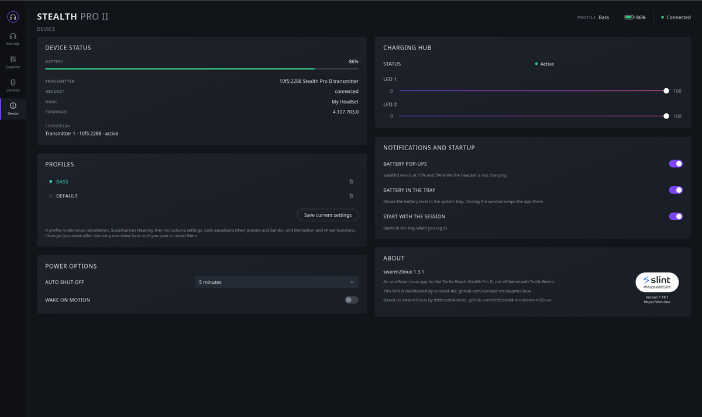

> [!NOTE]
> **Written with AI, tested on real hardware.** The code and documentation were written by an AI (Anthropic's
> Claude), and the headset protocol was reverse-engineered rather than taken from Turtle Beach, so the app changes
> your headset's settings in ways the manufacturer never documented. It only sends the writes the official Swarm II
> app was seen making, and it refuses firmware and storage commands outright. The code has been through an
> AI-assisted security and correctness audit and has been tested on a Stealth Pro II under Fedora and Ubuntu with
> KDE Plasma, but it has not had a line-by-line human review. It comes with no warranty (see [LICENSE](LICENSE)).

# swarm2linux

A Linux replacement for Turtle Beach's Swarm II app, starting with the **Stealth Pro II** headset. It is an
independent interoperability project, not affiliated with Turtle Beach.

This is [curxxed-mc](https://github.com/curxxed-mc)'s fork of
[swarm2linux by tbt9czsdd4-droid](https://github.com/tbt9czsdd4-droid/swarm2linux), which wrote the original app and
reverse-engineered the protocol. The fork adds profiles, editable custom EQ presets, voice commands and support for
the `10f5:2288` transmitter.

| Settings | Equalizer |
|---|---|
|  |  |
| **Controls** | **Device** |
|  |  |

## Features

- Every headset setting Swarm II offers on PC, except the master-volume mute toggle: Superhuman Hearing, noise
  cancellation, the microphone (sensitivity, monitoring, noise gate, AI noise reduction), game and mic EQ with
  custom presets, the button and wheel functions, power options and the charging hub's LEDs.
- A desktop app with a battery tray icon, a terminal app with vim keys, and a command line tool.
- Profiles: named sets of settings to switch between in one go.
- Voice commands (experimental): "Stealth, skip this song", recognised offline.
- A self-diagnostic that says how to fix what is wrong.

## Install

You need Linux with a systemd user session and PipeWire, and the headset's USB transmitter (or its USB-C cable).

```sh
git clone https://github.com/curxxed-mc/swarm2linux.git
cd swarm2linux
./install.sh
```

Then open **swarm2linux** from the app menu, or run `stealth-tui` in a terminal. Update with
`git pull && ./install.sh`, uninstall with `./install.sh --uninstall`. For a step-by-step guide per distribution,
what the script does, and troubleshooting, see [docs/install.md](docs/install.md). If something does not work, run
`stealthctl doctor`.

## Documentation

| | |
|---|---|
| [Installing](docs/install.md) | the script, step by step per distribution, updating, uninstalling, troubleshooting |
| [Desktop app](docs/desktop-app.md) | `stealth-gui`: the pages, the tray, themes |
| [Terminal app](docs/terminal-app.md) | `stealth-tui`: keys, mouse |
| [Profiles](docs/profiles.md) | saving and switching sets of settings |
| [Voice commands](docs/voice-commands.md) | what to say, choosing the microphone, when it misses |
| [stealthd](docs/stealthd.md) | the background service: settings, D-Bus interface |
| [stealthctl](docs/stealthctl.md) | the command line tool |
| [Protocol](docs/protocol.md) | what is known about the headset's protocol |
| [Reverse-engineering tools](docs/reverse-engineering.md) | how it works, and the scripts used to work it out |
| [Plan](docs/PLAN.md) | the roadmap and release notes |

## Supported hardware

| USB ID      | Device                                   |
|-------------|------------------------------------------|
| `10f5:2287` | Stealth Pro II PC, USB-A transmitter     |
| `10f5:2288` | Stealth Pro II transmitter               |
| `10f5:229b` | Stealth Pro II transmitter dock          |
| `10f5:2289` | Stealth Pro II PC headset on its USB-C cable (seen) |
| `10f5:229e` | Stealth Pro II headset on its USB-C cable (other SKU, from HaloBattery) |

## Safety

The tools only send frames that Turtle Beach's own app has been observed sending. They never send RACE storage
(`0x04xx`) or firmware-update (`0x1Cxx`) commands. Firmware updates are out of scope; use the official mobile app.

## License

MIT, see [LICENSE](LICENSE). The app is built with [Slint](https://slint.dev), which it uses under the Slint
Royalty-free Desktop, Mobile, and Web Applications License; that licence asks for the "Made with Slint" credit on
the app's Device page.
