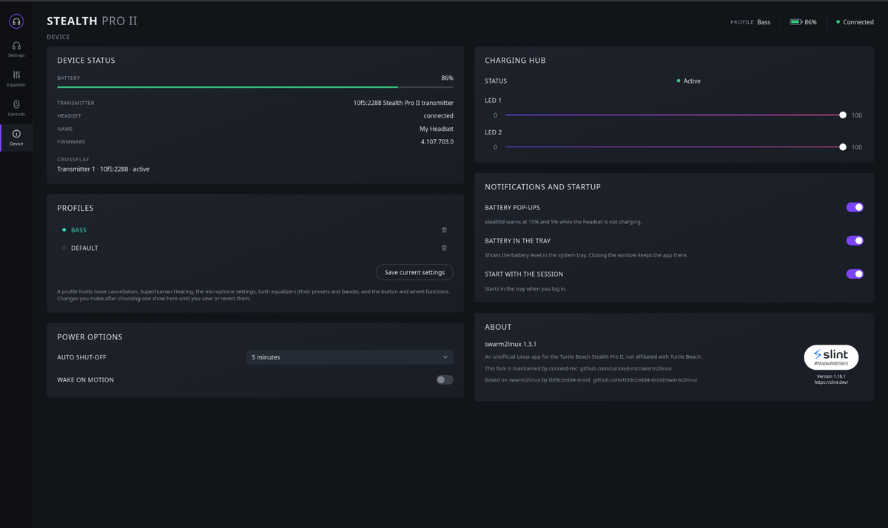

# stealth-gui (desktop app)

| Settings | Equalizer |
|---|---|
|  |  |
| **Controls** | **Device** |
|  |  |

A [Slint](https://slint.dev) app in the style of Swarm II, with four pages:

- **Settings:** master volume, Superhuman Hearing (mode and level), noise cancellation (ambient to full), and the
  microphone (sensitivity, monitoring, noise gate, AI noise reduction). The master volume is the headset's volume
  in the system's sound settings, the one KDE and the volume wheel change.
- **Equalizer:** game and mic EQ as a draggable 10-band graph and the onboard presets. Save the curve as a custom
  preset (five per EQ), delete one, or, after changing a custom preset's bands, **Update** it in place.
- **Controls:** what the mode button and the assignable wheel do.
- **Device:** battery, transmitters and firmware, [profiles](profiles.md), auto shut-off and wake on motion, the
  charging hub's LEDs, battery pop-ups, [voice commands](voice-commands.md), the tray icon, starting with the
  session, the self-diagnostic, and the colour theme: Swarm (the app's own look), the 22 palettes of the iced
  toolkit (Dracula, Nord, Solarized, Gruvbox, Catppuccin, Tokyo Night, Kanagawa and more, light and dark), or
  following the desktop's light or dark mode.

It is a client of [`stealthd`](stealthd.md) and needs it running.

## Tray

The tray icon shows the battery as a headset whose ear cups fill up, with a red badge under the headband while the
mic is muted. Its menu switches noise cancellation, Superhuman Hearing, the game EQ preset and the profile.

Closing the window keeps the app in the tray (turn the tray off on the Device page to quit on close), and
`stealth-gui --hidden` starts in the tray. **Start with the session** on the Device page starts it in the tray at
login. On GNOME the tray needs the "AppIndicator and KStatusNotifierItem Support" extension.

Built with Slint under its royalty-free licence; the Device page carries the credit.
